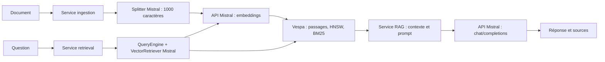

# RAG Mistral : FastAPI + Search Toolkit + Vespa

Backend autonome dans `C:\Users\redstone-aat\IdeaProjects\mistral-rag-backend`.
Python 3.12 à 3.14, uv et Docker Desktop (moteur Linux).

## Organisation

```text
mistral-rag-backend/
├── app/
│   ├── main.py                 # FastAPI, lifespan, gestion HTTP des erreurs
│   ├── bootstrap.py            # Assemblage des dépendances et fermeture des clients
│   ├── api/
│   │   ├── dependencies.py     # Injection des services
│   │   └── v1/
│   │       ├── routers/        # chat, documents, health
│   │       └── schemas/        # Entrées/sorties HTTP avec Pydantic
│   ├── core/                  # Configuration, erreurs, logging
│   ├── domain/
│   │   ├── models/             # Document, Chunk, SearchHit, Message, Answer
│   │   └── interfaces/         # Protocoles LLM, embeddings, vector store, chunker
│   ├── services/
│   │   ├── ingestion/          # Création des documents et indexation
│   │   ├── retrieval/          # Recherche et construction du contexte
│   │   └── generation/         # Prompts, sources numérotées et réponse RAG
│   └── infrastructure/
│       ├── mistral/            # Client HTTP, adapters LLM/embeddings/chunking
│       └── vector_store/       # Adapter Vespa et pont vers le Search Toolkit
├── tests/
│   ├── unit/                   # Services, contrats Mistral, règles d'architecture
│   ├── integration/            # Vespa réel, embeddings synthétiques
│   └── e2e/                    # Contrats HTTP avec dépendances substituées
├── vespa_app/migrations/       # Schéma et poids du classement Vespa
├── scripts/                    # Démo API, démo KV cache, setup Vespa
├── docker/Dockerfile.api
├── docker-compose.yml
├── pyproject.toml
├── uv.lock
├── .env.example
└── README.md
```

Les routes traduisent HTTP en appels aux services. Les services dépendent des
interfaces du domaine. Les adaptateurs implémentent ces interfaces ; seuls eux
connaissent Mistral, httpx et Vespa. `bootstrap.py` assemble le tout à chaque
startup et ferme les clients, même si l'initialisation échoue.

Les objets du domaine sont des dataclasses Python et les interfaces des Protocols.
Le domaine et les services n'importent ni FastAPI, ni Pydantic, ni le SDK Mistral.
Un test contrôle cette règle. Les schémas Pydantic sont réservés aux frontières
HTTP et à la configuration.

L'exemple ne crée pas de modules vides pour S3, Celery, OCR, conversations, sécurité,
Qdrant ou pgvector. Ils pourront s'ajouter pour un besoin réel. Les limites actuelles
restent celles d'une démonstration locale sans authentification ni séparation des
utilisateurs. Les tests e2e ne mesurent pas la qualité réelle du modèle.

## Démarrage local

Depuis le dossier du projet :

```powershell
uv sync --locked
# Uniquement si .env n'existe pas :
Copy-Item .env.example .env
# Renseigner MISTRAL_API_KEY dans .env.
.\scripts\setup-vespa.ps1
uv run --locked python -m uvicorn app.main:app --reload --host 127.0.0.1 --port 8000
```

Si uv n'est pas dans le PATH, utiliser l'exécutable installé sur cette machine :

```powershell
& 'C:\Users\redstone-aat\AppData\Local\com.LangflowDesktop\uv\uv.exe' sync --locked
```

Ou, après installation des dépendances :

```powershell
.\.venv\Scripts\python.exe -m uvicorn app.main:app --reload
```

Swagger : http://127.0.0.1:8000/docs. `Settings` charge le `.env` à la racine du
projet et accepte les variables d'environnement comme surcharges. La clé utilise
le type SecretStr et n'est pas écrite dans les logs applicatifs.

Dans un deuxième terminal :

```powershell
uv run --locked python scripts/demo.py
uv run --locked python scripts/kv_cache_demo.py
```

Chaque démo indexe une nouvelle offre et pose deux questions. Les appels Mistral
réels sont facturés. Les textes des embeddings et les passages du prompt sont
envoyés à l'API hébergée. Les tests remplacent ces appels.

## Routes versionnées

| Route | Fonction |
|---|---|
| GET /api/v1/health | Vérifie FastAPI uniquement |
| POST /api/v1/documents | Découpe, calcule les embeddings, indexe |
| POST /api/v1/search | Retourne les passages et leur score hybride |
| POST /api/v1/ask | Retourne la réponse, les sources et l'usage Mistral |

Les anciennes URLs `/health`, `/documents`, `/search` et `/ask` restent utilisables.
Swagger présente uniquement `/api/v1`. La nouvelle commande de démarrage est
`app.main:app` ; les anciens modules racine `app.py` et `rag.py` ont été remplacés.

Indexation :

```json
{"title":"Offre IA", "text":"Python, FastAPI, Mistral, RAG. Télétravail : trois jours par semaine."}
```

Recherche ou génération :

```json
{"question":"Combien de jours de télétravail ?", "top_k":3}
```

`/ask` conserve `answer`, `sources`, `usage` et `cached_prompt_tokens`. Chaque source
comprend son titre, son texte, son score, son identifiant, son source_id, sa position
et son numéro de citation. Les citations générées ne sont pas automatiquement
vérifiées. Sans passage indexé, la recherche retourne 404. Les erreurs fournisseur
et de stockage sont traduites en erreurs applicatives puis HTTP.

## Recherche et architecture Mistral

Mistral propose publiquement Vespa et PostgreSQL avec pgvector + pg_textsearch dans
son Search Toolkit ; son starter utilise Vespa et une recherche hybride. Ce projet
suit cette référence publique, sans prétendre reproduire la base privée de Le Chat.



Le découpage officiel est par caractères sans chevauchement. Chaque passage
conserve ses positions, son embedding de 1024 dimensions et ses métadonnées.
Vespa indexe un document par passage. La recherche hybride combine mots-clés OU
nearestNeighbor. Le premier classement combine proximité vectorielle (poids 1)
et BM25 (poids 0.2), puis un second classement ajoute le cosinus (poids 1).
Ces poids doivent être évalués sur des documents réels. Le score n'est pas une
probabilité ni un cosinus pur ; HNSW effectue une recherche approchée.

Le modèle d'embeddings reste `mistral-embed`. Le changer nécessite un nouveau
schéma et une réindexation. Le modèle de génération reste configurable.
L'usage des tokens d'embeddings est maintenant conservé dans les métadonnées
Vespa ; l'usage renvoyé par `/ask` correspond à la génération.

Les payloads REST se trouvent dans les adaptateurs Mistral :

```python
# POST https://api.mistral.ai/v1/embeddings
await client.post('embeddings', {'model': 'mistral-embed', 'input': texts})

# POST https://api.mistral.ai/v1/chat/completions
await client.post('chat/completions', {
    'model': model,
    'messages': messages,
    'temperature': 0,
    'max_tokens': 700,
    'prompt_cache_key': 'mini-job-rag-v1',
})
```

L'en-tête `Authorization: Bearer <clé>` est centralisé dans `MistralClient`.
Les anciens fichiers SQLite éventuels restent sur disque mais ne sont plus lus.
Réindexer leurs documents via `/api/v1/documents` si nécessaire.

## KV cache et prompt caching

| Mécanisme | Données conservées | Emplacement |
|---|---|---|
| Index RAG | Vecteurs, textes et métadonnées | Vespa local |
| KV cache | Clés et valeurs d'attention des tokens traités | Serveur d'inférence |
| Prompt caching | Calcul d'un préfixe commun entre requêtes | Infrastructure Mistral |

Le KV cache évite de recalculer K/V des anciens tokens. La démo indépendante montre
10 tokens projetés sans cache contre 4 avec cache, avec les mêmes sorties. Ce n'est
pas un modèle entraîné. L'API hébergée gère son propre KV cache ; le backend utilise
`prompt_cache_key` et conserve instructions et contexte avant la question. Un cache
hit n'est pas garanti : `cached_prompt_tokens` peut rester à zéro.

## Docker

Le volume `vespa-data` et le nom de projet Compose sont conservés, donc la
réorganisation ne réinitialise pas les documents. Vespa utilise les ports locaux
8085 (recherche/indexation) et 19075 (configuration). Le setup utilise `localhost`
pour la configuration, car le CLI génère un alias invalide avec une IP numérique.

L'API peut aussi tourner dans Docker, après déploiement du schéma :

```powershell
.\scripts\setup-vespa.ps1
docker compose --profile api up -d --build api
# Swagger reste http://127.0.0.1:8000/docs
```

Arrêter l'API locale avant de démarrer l'API Docker sur le même port.
L'image tourne avec un utilisateur non root et n'inclut pas le `.env`.
Compose injecte ses variables et configure l'adresse interne Vespa.

```powershell
docker compose ps
docker compose --profile api stop
# Reprise : docker compose --profile api start
```

## Vérification

```powershell
uv run --locked python -m pytest -q
uv run --locked ruff check app tests scripts
```

Pour inclure le test Vespa réel avec embeddings synthétiques, sans appel payant :

```powershell
$env:VESPA_INTEGRATION='1'
uv run --locked python -m pytest -q
Remove-Item Env:VESPA_INTEGRATION
```

Le test indexe trois documents, vérifie le signal lexical entre vecteurs identiques,
les positions, l'accès par un nouveau client et la génération sourcée avec un faux
LLM. Il supprime uniquement ses propres documents. Utiliser une instance dédiée
aux tests pour éviter que d'autres documents affectent leur classement.

## Références officielles

- [Backends du Search Toolkit](https://docs.mistral.ai/studio/search/search-toolkit/search-index)
- [Starter Mistral : Vespa + recherche hybride](https://github.com/mistralai/search-starter-app)
- [Quickstart](https://docs.mistral.ai/studio/search/search-toolkit/quickstart)
- [Schéma et ranking Vespa](https://docs.mistral.ai/studio/search/search-toolkit/search-index/vespa/anatomy)
- [API embeddings](https://docs.mistral.ai/api/endpoint/embeddings)
- [Prompt caching](https://docs.mistral.ai/studio/conversations/advanced/prompt-caching)
## Interface React, Vite et Tailwind

Les sources sont dans `frontend/` : pages React dans `src/pages`, composants dans `src/components`,
appels FastAPI dans `src/lib/api.js` et historique dans `src/hooks/useConversations.js`.
Les anciens fichiers HTML/JavaScript ont été remplacés. Les conversations locales existantes sont conservées.

### Développement

Dans deux terminaux, depuis la racine du projet :

```powershell
uv run uvicorn app.main:app --reload --host 127.0.0.1 --port 8001
```

```powershell
npm --prefix frontend ci
npm --prefix frontend run dev
```

Ouvrir http://127.0.0.1:5173. Vite transmet `/api` à FastAPI sur le port 8001.
Pour un autre port backend, définir `API_PROXY_TARGET` avant de lancer Vite.
Les données locales appartiennent à chaque origine : les conversations enregistrées sur le port 8001
restent accessibles sur 8001 ; le serveur de développement 5173 dispose de son propre stockage.

### Version compilée

```powershell
npm --prefix frontend ci
npm --prefix frontend run build
```

Vite génère `app/static/ui/`. FastAPI sert cette application sur `/` et `/admin/vespa`.
Après une modification du frontend, recompiler pour actualiser ces pages.
Le Dockerfile compile automatiquement le frontend dans une étape Node.js ; l’image finale utilise Python.
Compiler aussi le frontend avant d’exécuter les tests HTTP Python.

```powershell
npm --prefix frontend test
```

## Explorateur Vespa

Ouvrir `/admin/vespa` sur le serveur FastAPI (par exemple http://127.0.0.1:8001/admin/vespa).
La page React permet de consulter `cv_user` et `job_chunks`, leurs nombres de morceaux,
les textes, métadonnées et embeddings. La recherche est lexicale, sans appel Mistral.
L’API `/api/v1/admin/vespa` est en lecture seule et limite les collections à ces deux schémas.
La pagination affiche 20 morceaux par page, jusqu’à un offset de 1 000.
Cet explorateur local ne dispose pas d’authentification ; conserver le serveur sur l’adresse loopback.


Ouvrir http://127.0.0.1:8000/ après avoir lancé `uv run uvicorn app.main:app --reload`.
La page React/Tailwind propose un chat classique avec historique local, plusieurs conversations,
copie des réponses et blocs de code. Entrée envoie le message ; Maj+Entrée ajoute une ligne.

`POST /api/v1/chat` transmet les messages précédents à Mistral sans dépendre de la recherche Vespa.
Le modèle est `mistral-large-4`, configurable avec `MISTRAL_DIRECT_CHAT_MODEL` dans `.env`.
Configurer `MISTRAL_API_KEY` côté serveur. Les conversations sont conservées dans le navigateur
sur cet appareil et envoyées à Mistral lors de chaque requête. Les réponses sont affichées une fois
la génération terminée. Cette interface locale est inspirée de Le Chat, sans affiliation officielle.
